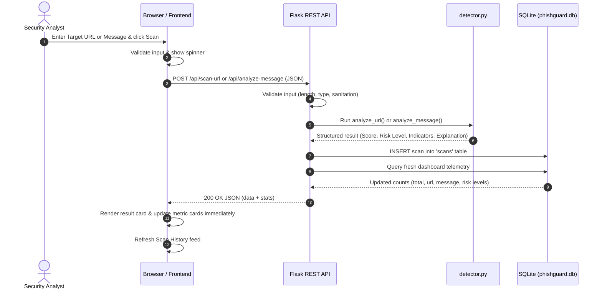

# PHISHGUARD: Real-Time Phishing Detection & Analysis

[](https://www.python.org/)
[](https://flask.palletsprojects.com/)
[](https://www.sqlite.org/)
[](#detection-engine)
[-brightgreen.svg)](#testing)

A real-time cybersecurity web application that analyzes user-submitted web addresses (URLs) and message text for phishing indicators, deceptive patterns, and social engineering lures.

PhishGuard combines a high-performance Flask REST API, a transparent rule-based heuristic detection engine, an ACID-compliant SQLite datastore, and a cybersecurity Security Operations Center (SOC)-themed single-page frontend.

---

## Key Features

- **Real-Time URL Scanner**: Evaluates web addresses using deterministic RFC-standard structural heuristics without visiting or executing untrusted links.
- **Real-Time Message Analyzer**: Evaluates plain-text messages, emails, and SMS alerts for urgency coercion, fake authority threats, and credential/financial lures.
- **Transparent Scoring System**: Generates a 0–100 risk score mapped to four risk tiers (*Low Risk*, *Suspicious*, *High Risk*, *Critical*), backed by triggered indicators and explanations.
- **SQLite Database (`phishguard.db`)**: Persists every scan record with full indicator metadata using parameterized queries.
- **Live SOC Telemetry Dashboard**: Real-time aggregation of total scans, scan types, and risk tier distribution calculated directly from the database.
- **Audit History & Inspector**: Complete historical audit log with type/risk filtering, target search, indicator inspection modals, and a database clear trigger.
- **Zero Mock / Fake Data**: Every statistic and analysis result is computed from user input and persisted to SQLite.

---

## Technology Stack

| Layer | Technologies & Tools |
| :--- | :--- |
| **Frontend** | HTML5 Semantic Architecture, Vanilla CSS (SOC Dark Theme), JavaScript (ES6+ Fetch API) |
| **Backend** | Python 3.12, Flask 3.1, Werkzeug |
| **Detection Engine** | Custom rule-based heuristic engine (`detector.py`), regex parsing, RFC 3986 URL parsing |
| **Database** | SQLite3 (`phishguard.db`) with WAL journal mode and parameterized queries |
| **Testing** | Python `unittest` framework, integration test suite, end-to-end pipeline verification |

---

## Project Structure

```text
phishguard/
├── app.py                         # Primary Flask application and REST API routes
├── detector.py                    # Rule-based heuristic phishing detection engine
├── database.py                    # SQLite schema, query layer, and telemetry aggregation
├── requirements.txt               # Application dependencies
├── README.md                      # Comprehensive documentation
├── test_phishguard.py             # 19 Unit & integration test cases
├── test_realtime_verification.py  # End-to-end automated pipeline test
├── templates/
│   └── index.html                 # SOC dashboard single-page interface
└── static/
    ├── css/
    │   └── style.css              # Cyber dark theme design system
    └── js/
        └── app.js                 # Real-time client-side controller (Fetch API)
```

---

## Installation & Setup

### 1. Prerequisites
- Python 3.10+ installed on your system.
- Git (optional, for version control).

### 2. Clone or Navigate to the Project Directory
```bash
cd c:\Users\takme\Desktop\taks2
```

### 3. Create and Activate a Virtual Environment
**On Windows (PowerShell / Command Prompt):**
```powershell
python -m venv venv
.\venv\Scripts\activate
```

**On Linux / macOS:**
```bash
python3 -m venv venv
source venv/bin/activate
```

### 4. Install Dependencies
```bash
pip install -r requirements.txt
```

---

## Running the Application

Start the Flask development server:
```powershell
python app.py
```

The application will start and listen locally:
```text
 * Running on http://127.0.0.1:5000
```

Open your browser and navigate to **[http://127.0.0.1:5000](http://127.0.0.1:5000)**.

---

## Real-Time Architecture & Workflow



---

## API Reference

### 1. Scan URL
- **Endpoint**: `POST /api/scan-url`
- **Headers**: `Content-Type: application/json`
- **Request Body**:
  ```json
  {
    "url": "https://example.com"
  }
  ```
- **Success Response (200 OK)**:
  ```json
  {
    "success": true,
    "data": {
      "id": 1,
      "target": "https://example.com",
      "score": 0,
      "risk_level": "Low Risk",
      "indicators": [],
      "explanation": "No high-risk structural indicators...",
      "timestamp": "2026-10-11T10:00:00.000000+00:00",
      "scan_type": "url"
    },
    "stats": {
      "total_scans": 1,
      "url_scans": 1,
      "message_scans": 0,
      "low_risk": 1,
      "suspicious": 0,
      "high_risk": 0,
      "critical": 0
    }
  }
  ```

### 2. Analyze Message
- **Endpoint**: `POST /api/analyze-message`
- **Headers**: `Content-Type: application/json`
- **Request Body**:
  ```json
  {
    "message": "Urgent: Your account is suspended. Verify credentials within 24 hours."
  }
  ```
- **Success Response (200 OK)**:
  ```json
  {
    "success": true,
    "data": {
      "id": 2,
      "target": "Urgent: Your account is suspended. Verify credentials within 24 hours.",
      "score": 46,
      "risk_level": "Suspicious",
      "indicators": [
        {
          "id": "urgency_extreme",
          "category": "Urgency & Coercion",
          "title": "Artificial Urgency & Time Pressure",
          "weight": 22
        }
      ],
      "explanation": "Suspicious social engineering indicators identified...",
      "timestamp": "2026-10-11T10:01:00.000000+00:00",
      "scan_type": "message"
    },
    "stats": { ... }
  }
  ```

### 3. Get Scan History
- **Endpoint**: `GET /api/history?limit=100`
- **Success Response (200 OK)**:
  ```json
  {
    "success": true,
    "history": [ ... ],
    "stats": { ... }
  }
  ```

### 4. Clear Scan History
- **Endpoint**: `DELETE /api/history`
- **Success Response (200 OK)**:
  ```json
  {
    "success": true,
    "message": "Successfully deleted 2 scan record(s) from database.",
    "deleted_count": 2,
    "stats": {
      "total_scans": 0,
      "url_scans": 0,
      "message_scans": 0,
      "low_risk": 0,
      "suspicious": 0,
      "high_risk": 0,
      "critical": 0
    }
  }
  ```

### 5. Get Real-Time Statistics
- **Endpoint**: `GET /api/stats`
- **Success Response (200 OK)**:
  ```json
  {
    "success": true,
    "stats": { ... }
  }
  ```

---

## Risk Scoring System

Risk scores are computed transparently by aggregating assigned indicator weights up to a maximum bounded score of 100:

| Risk Score | Risk Tier | Indicator Characteristics |
| :---: | :---: | :--- |
| **0 – 24** | **Low Risk** | Standard syntax, standard ports, HTTPS or common HTTP, no coercive patterns. |
| **25 – 49** | **Suspicious** | Shortened URLs, high-risk TLDs, single phishing keywords, or mild urgency pressure. |
| **50 – 74** | **High Risk** | Deep subdomains, brand typosquatting, credential harvesting keywords, explicit threats. |
| **75 – 100** | **Critical** | Raw IP hostnames, authority `@` redirect obfuscation, extreme multi-vector coercion. |

---

## Security Considerations

1. **Non-Execution & Isolation**: Submitted URLs are **never** visited, resolved, or requested externally. The application performs static heuristic parsing only.
2. **Input Sanitization & Validation**:
   - String length validation (URLs capped at 2,048 chars, messages capped at 10,000 chars).
   - Strict JSON type validation prevents unexpected types or payload flooding.
   - Frontend output escaping (`escapeHtml`) prevents Cross-Site Scripting (XSS).
3. **Database Protection**: All SQLite database queries use parameterized SQL statements (`?` placeholders) to prevent SQL injection vulnerabilities.
4. **Security Headers**: Standard defense-in-depth headers applied on all responses (`X-Content-Type-Options: nosniff`, `X-Frame-Options: SAMEORIGIN`, `X-XSS-Protection`).
5. **Zero Sensitive Data Storage**: PhishGuard does not store credentials, passwords, PINs, or financial payment tokens.

---

## Testing

### Running Unit & Integration Tests
Execute the comprehensive test suite (19 test cases):
```powershell
python -m unittest test_phishguard.py
```
Expected output:
```text
Ran 19 tests in 0.523s
OK
```

### Running Real-Time Verification
Execute the automated end-to-end pipeline verification test:
```powershell
python test_realtime_verification.py
```
Expected output:
```text
======================================================================
  ALL REAL-TIME VERIFICATION TESTS COMPLETED SUCCESSFULLY!
  Architecture Verified: Frontend <-> Flask <-> detector.py <-> SQLite
======================================================================
```

---

## Disclaimer

> **IMPORTANT**: PhishGuard evaluates submitted content using deterministic rule-based heuristic indicators and behavioral pattern recognition. Detections reflect statistical risk indicators and do not constitute an absolute guarantee or proof that any analyzed URL or message is definitively safe or malicious. Always utilize comprehensive defense-in-depth security measures.
